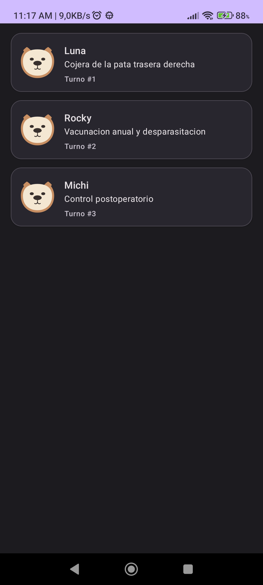

# HU 2.0 — Home Administrador de Citas (VET_ANDROID)

Notas de la historia y de lo que ya quedó implementado en este repositorio.

## Reparto de la HU (Jira)

| Subtarea | Responsable | Estado |
|---|---|---|
| Header curvo, título, perro y marca | Santos | pendiente |
| Item de la lista: avatar circular, nombre, síntoma y turno (Glide) | Trujillo | contenedor base en `item_cita.xml` |
| RecyclerView + Adapter + ViewHolder | Medina | hecho |
| HomeViewModel observando `LiveData<List<Cita>>` del DAO | Medina | hecho |
| Botón atrás del Home → `finishAffinity()` | Agudelo | pendiente |
| QA: refresco automático al crear, editar y borrar | Trujillo | pendiente |

## Archivos de esta parte

- `app/src/main/java/com/example/dogapp/adapter/CitaAdapter.kt`
- `app/src/main/java/com/example/dogapp/adapter/CitaViewHolder.kt`
- `app/src/main/java/com/example/dogapp/viewmodel/HomeViewModel.kt`
- `app/src/main/res/layout/item_cita.xml` (contenedor base del item)
- `app/src/main/res/layout/fragment_home.xml` (contenedor mínimo de la pantalla)
- `app/src/main/java/com/example/dogapp/view/home/HomeFragment.kt`
- `app/src/debug/…/HomePreviewActivity.kt` (solo debug, para revisar sin login)

El `CitaDao` ya existía y expone `Flow`; `HomeViewModel` lo convierte con `asLiveData()`,
así que el Home se refresca solo cuando Room emite un cambio (crear, editar o borrar).

## Cómo verlo

Opción A — Android Studio: ejecutar la configuración `app` y abrir el lanzador
**Home Admin Citas (debug)**. Siembra tres citas de ejemplo cuando la tabla está vacía.

Opción B — por consola:

```bash
./gradlew :app:assembleDebug
adb install -r app/build/outputs/apk/debug/app-debug.apk
adb shell am start -n com.example.dogapp/com.example.dogapp.HomePreviewActivity
```

La `HomePreviewActivity` vive en `src/debug`, así que no entra al APK de release ni
interfiere con el login ni con la navegación que están en otras subtareas.

## Evidencia

Listado pintado en dispositivo físico (Android 13):



## Pendiente para cerrar la HU

- Header curvo (Santos) y botón flotante de nueva cita.
- Estilo definitivo del item y QA del refresco automático (Trujillo).
- Botón atrás → `finishAffinity()` (Agudelo).
- Navegación al detalle de la cita.
